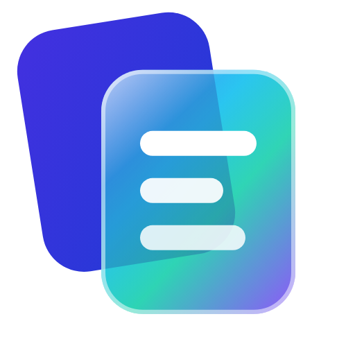
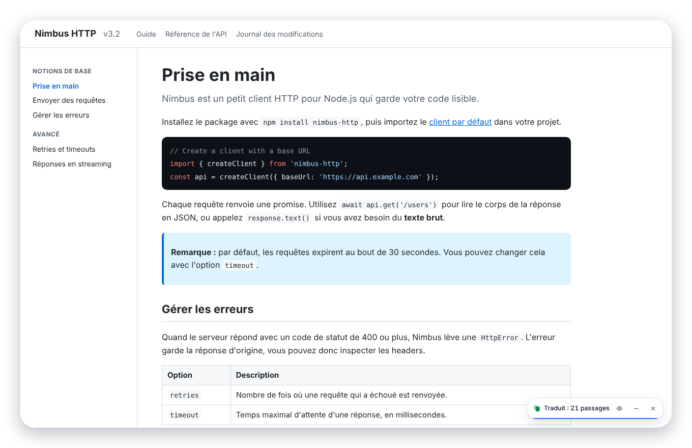

<p align="center"></p>

<h1 align="center">DevDocTrad</h1>

<p align="center"><b>Traduit fidèlement la documentation technique et les sites pour programmeurs, sans jamais toucher au code.</b><br>
Chrome · Edge · Brave · Firefox — gratuit — licence MIT</p>

<p align="center"><a href="https://devdoctrad.vercel.app/"><b>Site : devdoctrad.vercel.app</b></a> · <a href="#installation">Installation</a> · <a href="#créer-une-clé-gratuite">Créer une clé gratuite</a> · <a href="#utilisation">Utilisation</a> · <a href="#english">English</a></p>



Pour tous ceux qui galèrent avec une doc en anglais ou dans une autre langue : documentation officielle, README et issues GitHub, Stack Overflow, forums, blogs techniques, pages de frameworks.

- **Traduction fidèle**, phrase par phrase, sans résumé, sans omission, sans ajout. L'extension traduit, elle n'explique pas.
- **Le code reste intact** : commandes, noms de fonctions, API, chemins et URL ne sont jamais traduits. Les liens, le gras et les blocs `code` restent en place.
- **Dans ta langue** : par défaut, la langue de ton navigateur (français, russe, espagnol, japonais… 37 langues). Tu peux en choisir une autre dans les réglages.
- **Original ou bilingue** : remplace le texte, ou affiche la traduction sous chaque phrase. Un clic pour revenir à l'original exact.
- **Gratuit** : utilise les paliers gratuits de Gemini, Groq, Mistral et OpenRouter avec tes propres clés, ou un modèle local avec Ollama. Une clé payante est bloquée tant que tu n'as pas réglé un plafond.
- **Privé** : aucune statistique, aucun pistage. Tes clés restent dans ton navigateur.
- **Agréable à utiliser** : interface en verre façon Apple, thème clair, sombre ou automatique, badge très discret sur les pages.

---

## Installation

L'extension n'est pas encore publiée sur les boutiques. En attendant, l'installation se fait à la main, en quelques clics. Les fichiers prêts à installer sont dans le dossier [`release/`](release/).

### Chrome, Edge ou Brave

1. Télécharge le fichier [`release/devdoctrad-chrome-1.0.0.zip`](release/devdoctrad-chrome-1.0.0.zip) : ouvre le lien, puis clique sur le bouton de téléchargement (« Download raw file ») en haut à droite du fichier.
2. Décompresse ce fichier zip dans un dossier que tu garderas (par exemple `Documents/DevDocTrad`). Ne supprime pas ce dossier ensuite : le navigateur charge l'extension depuis lui.
3. Ouvre la page des extensions en tapant dans la barre d'adresse :
   - Chrome : `chrome://extensions`
   - Edge : `edge://extensions`
   - Brave : `brave://extensions`
4. Active le **Mode développeur** (interrupteur en haut à droite dans Chrome et Brave, dans la colonne de gauche dans Edge).
5. Clique sur **Charger l'extension non empaquetée**.
6. Choisis le dossier décompressé à l'étape 2 (celui qui contient le fichier `manifest.json`).
7. L'icône de DevDocTrad apparaît dans le menu des extensions (pièce de puzzle). Clique sur l'épingle à côté de DevDocTrad pour la garder visible dans la barre d'outils.

### Firefox

1. Télécharge le fichier [`release/devdoctrad-firefox-1.0.0.zip`](release/devdoctrad-firefox-1.0.0.zip) : ouvre le lien, puis clique sur le bouton de téléchargement en haut à droite du fichier.
2. Tape `about:debugging#/runtime/this-firefox` dans la barre d'adresse.
3. Clique sur **Charger un module complémentaire temporaire…**
4. Choisis le fichier zip téléchargé à l'étape 1.
5. Firefox version 140 ou plus récente est nécessaire.

Attention : sous Firefox, un module chargé de cette façon est **temporaire** et disparaît à la fermeture du navigateur. Il faut refaire les étapes 2 à 4 à chaque démarrage, jusqu'à la publication sur addons.mozilla.org.

---

## Créer une clé gratuite

L'extension a besoin d'au moins une clé d'API (ou d'Ollama). Toutes les options ci-dessous sont **gratuites**. Tu peux en ajouter plusieurs : quand l'une atteint sa limite, l'extension passe automatiquement à la suivante, et jamais à une clé payante.

**Ne publie jamais une clé sur GitHub ou ailleurs.** Elle reste dans le stockage local de ton navigateur.

### Ajouter la clé dans l'extension

1. Clique sur l'icône DevDocTrad, puis sur la roue dentée (Réglages).
2. Dans l'onglet **Clés**, choisis le fournisseur dans la liste, puis clique sur **Ajouter**.
3. Colle ta clé dans le champ **Clé**.
4. Clique sur **Charger les modèles**, puis choisis un modèle dans la liste du champ **Modèle (pages simples)**.
5. Clique sur **Tester**. Le message « Clé valide » confirme que tout fonctionne.

### Gemini (Google)

1. Va sur [aistudio.google.com](https://aistudio.google.com/) et connecte-toi avec un compte Google.
2. Clique sur **Get API key**, puis **Create API key**.
3. **Ne lie aucun compte de facturation** : sans facturation, la clé reste gratuite et ne peut rien te coûter.
4. Copie la clé et ajoute-la dans l'extension (fournisseur Gemini).

À savoir : en gratuit, Google peut réutiliser les textes envoyés.

### Groq

1. Va sur [console.groq.com](https://console.groq.com/) et crée un compte (aucune carte demandée).
2. Ouvre **API Keys**, puis **Create API Key**.
3. Copie la clé et ajoute-la dans l'extension (fournisseur Groq).

Au-delà de la limite gratuite, Groq renvoie simplement une erreur, jamais une facture.

Modèle conseillé : `openai/gpt-oss-120b` (le meilleur en test réel) ; `openai/gpt-oss-20b` est plus rapide, un peu moins juste. Attention : la limite est **par compte Groq**, pas par clé. Plusieurs clés du même compte partagent la même limite ; pour que la bascule automatique serve à quelque chose, il faut des clés de comptes ou de fournisseurs différents.

### Mistral

1. Va sur [console.mistral.ai](https://console.mistral.ai/) et crée un compte.
2. Choisis le mode gratuit (aucune carte demandée).
3. Ouvre **API Keys**, puis crée une clé.
4. Copie la clé et ajoute-la dans l'extension (fournisseur Mistral).

À savoir : en gratuit, les requêtes peuvent servir à l'entraînement ; tu peux le désactiver dans la console Mistral.

### OpenRouter

1. Va sur [openrouter.ai](https://openrouter.ai/) et crée un compte.
2. Ouvre **Keys**, puis **Create Key**.
3. Copie la clé et ajoute-la dans l'extension (fournisseur OpenRouter).
4. Choisis **uniquement un modèle dont le nom finit par `:free`**. L'extension refuse les autres modèles en mode gratuit.

Limite gratuite : environ 50 requêtes par jour. N'achète jamais de crédit pour cette extension.

### Ollama (local, facultatif)

Ollama fait tourner un modèle sur ton ordinateur : gratuit, rien ne quitte ta machine, mais il faut un ordinateur assez puissant.

1. Installe Ollama depuis [ollama.com](https://ollama.com/download).
2. Ouvre un terminal et télécharge un modèle, par exemple : `ollama pull qwen2.5:7b`. Testés en vrai (carte graphique de 6 Go) : `qwen2.5:7b` (le meilleur, 36 langues), `qwen2.5:3b` (le plus rapide), `mistral:7b`, `llama3.2:3b`, `gemma3:4b`. Un petit modèle se trompe plus souvent ; l'extension laisse alors le passage en original plutôt que d'afficher une traduction douteuse.
3. Dans les réglages de l'extension, choisis **Ollama (local)** puis **Ajouter**, et accepte la permission demandée par le navigateur.
4. Clique sur **Charger les modèles**, choisis ton modèle, puis **Tester**.
5. Si le test affiche une erreur 403 : définis la variable d'environnement `OLLAMA_ORIGINS` avec la valeur `chrome-extension://*,moz-extension://*`, redémarre Ollama, puis clique à nouveau sur **Tester**.

Ollama est utilisé en secours quand toutes les clés gratuites sont en pause, et en premier sur les pages sensibles (banque, mail, connexion) quand tu les traduis à la main.

---

## Utilisation

- **Traduire une page** : clique sur l'icône DevDocTrad, puis sur **Traduire cette page**. Ou utilise le raccourci **Alt+Maj+T**.
- **Revenir à l'original** : bouton **Voir l'original** dans le petit badge en bas à droite de la page, dans le popup, ou de nouveau **Alt+Maj+T**.
- **Traduire automatiquement un site** : sur un site que tu lis souvent, ouvre le popup et active **Traduire automatiquement ce site**. Le navigateur te demande la permission pour ce site uniquement.
- **Changer de langue** : directement dans le popup (menu **Langue cible**, 37 langues), ou dans Réglages > **Traduction**. Par défaut : la langue de ton navigateur.
- **Mode bilingue** : Réglages, onglet **Traduction**, **Affichage**, **Bilingue**.
- **Glossaire** : Réglages, onglet **Glossaire**, pour les termes à ne jamais traduire ou à toujours traduire d'une certaine façon.
- **Thème clair ou sombre** : Réglages, section **Apparence** (Système, Clair ou Sombre).
- **Changer le raccourci** : Chrome, `chrome://extensions/shortcuts` ; Firefox, gestionnaire de modules, roue dentée, « Gérer les raccourcis ».

Pages jamais traduites automatiquement : pages avec un champ mot de passe, banques, mails, pages de connexion (liste modifiable dans les réglages). Le bouton manuel fonctionne quand même.

Pages qu'aucune extension ne peut traduire : pages internes du navigateur (`chrome://`, `about:`), boutiques d'extensions, lecteur PDF intégré.

---

## Pour les développeurs

Prérequis : Python 3.8 ou plus récent, Node.js 20 ou plus récent (seulement pour les tests).

```bash
python3 build.py
```

Cette commande reconstruit `dist/chrome`, `dist/firefox`, les deux zips, les copies dans `release/` et affiche leurs empreintes SHA-256.

```bash
npm install
```

```bash
npm test
```

Les tests automatiques (Node + jsdom) utilisent de faux fournisseurs : aucun appel réseau réel.

```bash
node tools/e2e.js
```

Test de bout en bout dans un vrai Chromium (Playwright), avec une page de démo et un faux serveur Ollama local ; il produit aussi les captures d'écran de `store/screenshots/`. Autres scripts : `node tools/qa_shots.js` (captures de contrôle du popup et du badge), `node tools/export_logo.js` (exports du logo), `node tools/promo.js` (images promotionnelles).

Organisation : `src/` (code de l'extension), `manifests/` (manifestes Chrome et Firefox), `tests/`, `tools/` (icônes, textes de l'interface, démo, test de bout en bout), `docs/` (site), `store/` (fiches des boutiques), `PLAN.md` (cahier des charges), `design/` (direction artistique, spécification, logo, contrôle visuel).

Les textes de l'interface se modifient dans `tools/gen_locales.py` (français et anglais) et `tools/locales/<langue>.json` (34 autres langues), puis `python3 tools/gen_locales.py`.

## Licence

MIT : chacun peut reprendre, modifier et redistribuer ce code, y compris dans un autre projet, à condition de garder la mention de licence. Voir [LICENSE](LICENSE).

## Confidentialité

Voir [PRIVACY.md](PRIVACY.md). En bref : le texte des pages que tu traduis part uniquement vers le fournisseur que tu as choisi (ou reste sur ta machine avec Ollama). Aucune donnée n'est envoyée au développeur.

---

## English

**DevDocTrad faithfully translates developer documentation and programming websites, without ever touching the code.** By default it translates into your browser's language (37 languages available); you can pick another one in the settings.

- Sentence by sentence, no summary, no omission, no addition.
- Code, commands, function names, APIs, paths and URLs are never translated; links, bold text and `code` elements stay in place.
- Replace mode or bilingual mode, one click back to the exact original.
- Free: uses the free tiers of Gemini, Groq, Mistral and OpenRouter with your own keys, or a local model with Ollama. Paid keys are blocked until you set a daily cap.
- No analytics, no tracking. Keys stay in your browser's local storage.

### Install (Chrome, Edge, Brave)

1. Download [`release/devdoctrad-chrome-1.0.0.zip`](release/devdoctrad-chrome-1.0.0.zip) and unzip it into a folder you will keep.
2. Open `chrome://extensions` (or `edge://extensions`, `brave://extensions`).
3. Turn on **Developer mode**.
4. Click **Load unpacked** and select the unzipped folder (the one containing `manifest.json`).

### Install (Firefox 140+)

1. Download [`release/devdoctrad-firefox-1.0.0.zip`](release/devdoctrad-firefox-1.0.0.zip).
2. Open `about:debugging#/runtime/this-firefox`.
3. Click **Load Temporary Add-on…** and select the zip file. (Temporary: it is removed when Firefox closes.)

### Add a free key

Open the settings (gear icon in the popup), **Keys** tab, choose a provider, click **Add**, paste your key, click **Load models**, pick a model, then **Test**. Free keys: [Google AI Studio](https://aistudio.google.com/) (do not link billing), [Groq](https://console.groq.com/), [Mistral](https://console.mistral.ai/) (free mode), [OpenRouter](https://openrouter.ai/) (only models ending with `:free`), or [Ollama](https://ollama.com/download) locally. Never publish a key.

### Use

Click the toolbar icon, then **Translate this page**, or press **Alt+Shift+T**. Press it again to go back to the original.
